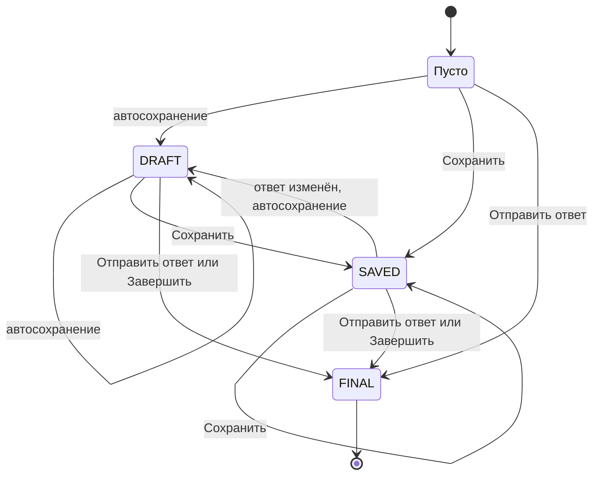
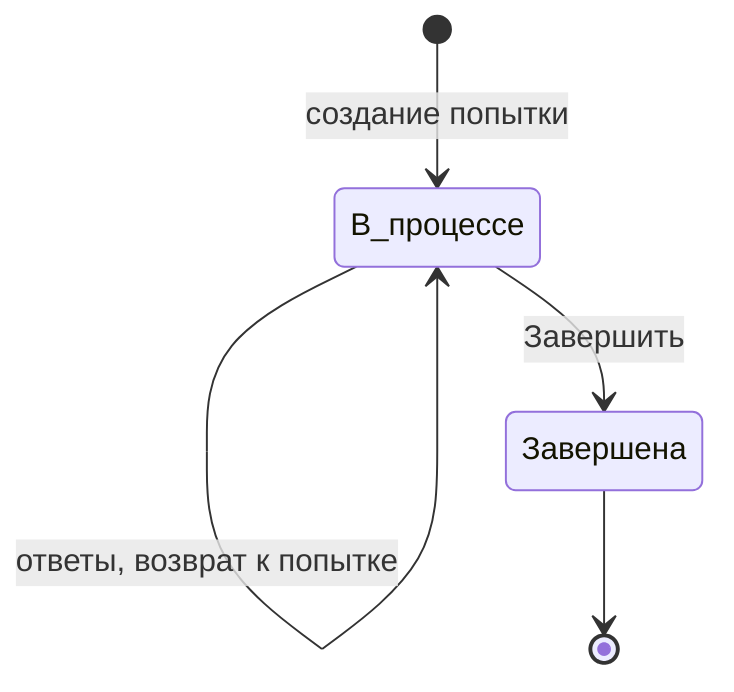

# Состояния попытки и ответа (роль 4)

Для ролей 2 и 3: от этих состояний зависят кнопки, индикаторы и блокировки на экране попытки.

## Ответ на задание

Статус хранится в `UserAnswer.status` (ТЗ, п. 4.3.2). Пока пользователь ничего не ввёл,
записи ответа нет — это состояние «нет ответа».

| Состояние | Как возникло | Можно менять ответ | Кнопки | Метка на панели номеров |
|---|---|---|---|---|
| нет ответа | ответ не вводили | да | «Сохранить» и «Отправить» неактивны, пока поле пустое | пусто |
| DRAFT | автосохранение: при смене задания и раз в 30 с (FR-032) | да | «Сохранить», «Отправить ответ» | черновик |
| SAVED | нажата «Сохранить» (FR-032) | да | «Сохранить», «Отправить ответ» | сохранён |
| FINAL | нажата «Отправить ответ» или попытка завершена (FR-033, FR-034) | **нет** | недоступны; рядом подсказка «Ответ отправлен, изменить его нельзя» | отправлен |

Переходы:

Пояснения:

- Переход SAVED → DRAFT после правки ответа — моё предложение: ТЗ не говорит, что станет
  со статусом, если сохранённый ответ изменили. Так статус всегда честный: «сохранён» значит,
  что на сервере именно то, что на экране.
- Из FINAL выхода нет. Попытка записать ответ в FINAL — ошибка 409.
- Правильность ответа (`is_correct`) до завершения попытки не показывается и не передаётся (FR-033).
- Индикатор «Сохранено в ЧЧ:ММ» берёт время из `updated_at` последнего успешного сохранения.

## Попытка

В ТЗ у `TestAttempt` нет поля статуса, состояние определяется по `finished_at`.

| Состояние | Признак | Что разрешено | Что видит пользователь |
|---|---|---|---|
| в процессе | `finished_at` пусто | вводить, сохранять, отправлять ответы, переходить между заданиями, завершить; вернуться к попытке позже (FR-038) | экран попытки, кнопка «Завершить» |
| завершена | `finished_at` заполнено | только смотреть результат; изменять ответы нельзя (FR-034) | экран результата |

Что происходит при «Завершить» (FR-034): все ответы DRAFT и SAVED становятся FINAL и проверяются,
фиксируется время окончания, считаются первичные баллы и процент. Неотвеченные задания — 0 баллов.
Перед отправкой запроса показывается подтверждение: «Завершить попытку? Неотвеченные задания
получат 0 баллов. Изменить ответы после этого будет нельзя.»

## Что разрешено в каждом месте экрана

| Элемент | в процессе | завершена |
|---|---|---|
| Поле ответа | редактируется, если ответ не FINAL | заблокировано, показан результат |
| «Сохранить» | активна, если ответ не FINAL и поле не пусто | нет на экране |
| «Отправить ответ» | активна, если ответ не FINAL и поле не пусто | нет на экране |
| «Завершить» | активна | нет на экране |
| «Верно / неверно» и эталон | скрыты (FR-033) | показаны (FR-039) |
